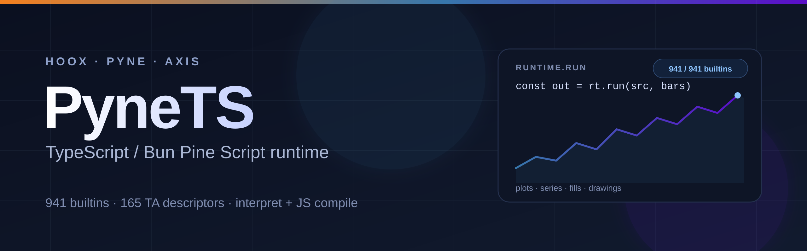
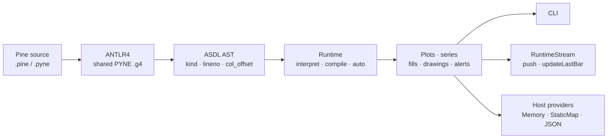
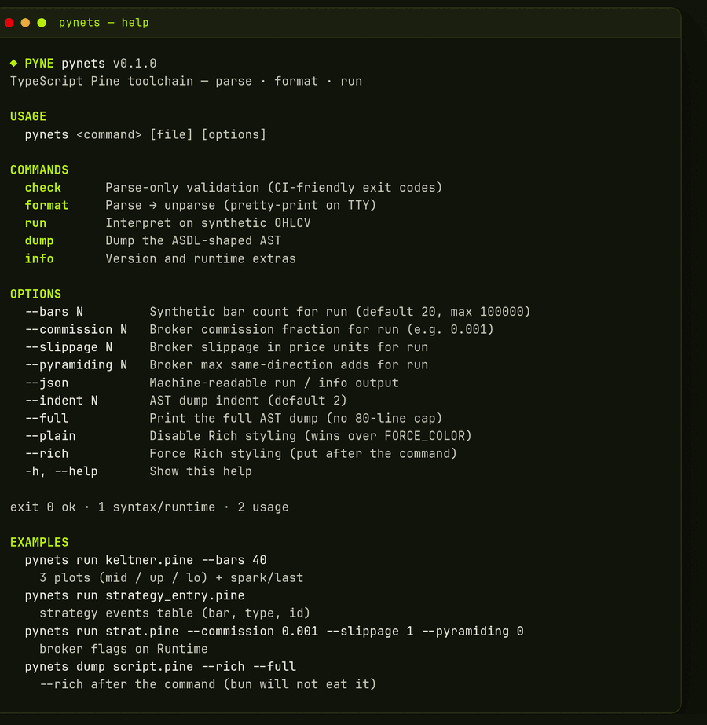
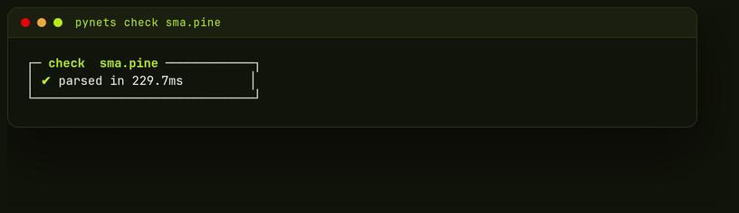
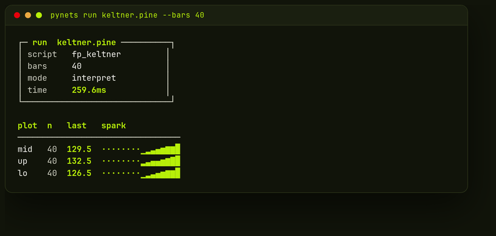
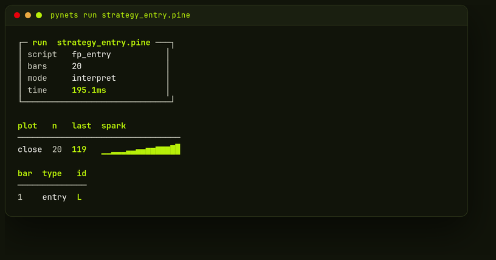
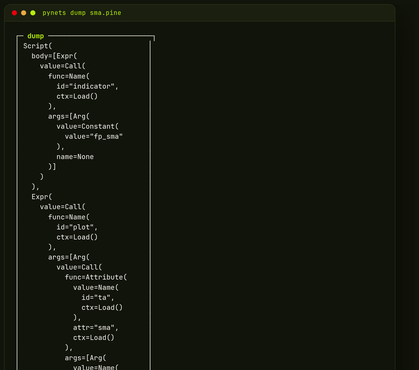

<!--
  Copyright (c) 2024–2026 HOOX · jango-blockchained (hoox-sh)
  SPDX-License-Identifier: AGPL-3.0-or-later
-->

# PyneTS

**TypeScript / Bun library for Pine Script — parse, unparse, interpret, compile, and stream.**

**0.11.0** · npm [`@hoox-sh/pynets`](https://www.npmjs.com/package/@hoox-sh/pynets)

<div align="center">



[](https://github.com/hoox-sh/hoox)
[](https://github.com/hoox-sh/pyne)
[](https://github.com/hoox-sh/axis)
[](https://github.com/hoox-sh/pynets/actions/workflows/ci.yml)
[](https://codecov.io/gh/hoox-sh/pynets)
[](https://www.npmjs.com/package/@hoox-sh/pynets)
[](LICENSE)

<br/>

[](https://bun.sh)
[](https://nodejs.org/)
[](https://www.typescriptlang.org/)
[](test)
[](PARITY.md)
[](PARITY.md)
[](https://www.npmjs.com/package/@hoox-sh/pynets)
[](CONTRIBUTING.md)

[hoox.sh](https://hoox.sh) · [PyneTS docs](https://hoox.sh/pyne/docs/pynets) · [parity](PARITY.md) · [changelog](CHANGELOG.md)

</div>

PyneTS is the TypeScript/Bun member of the [PYNE](https://github.com/hoox-sh/pyne) toolchain. It is the same grammar, the same ASDL AST, and the same runtime contract as Python `pynescript` — exposed as a library and a TTY CLI.

Python [`pynescript.runtime`](https://github.com/hoox-sh/pyne) is the **source of truth**. When semantics disagree, Python wins. This is not a TradingView platform certification.

---

## Numbers

| Metric                        | Value                                                           |
| ----------------------------- | --------------------------------------------------------------- |
| PYNE-registered builtins      | **941 / 941** resolve                                           |
| TA methods on shared tables   | **165**                                                         |
| Dispatch names (bare + `ta.`) | **317**                                                         |
| Descriptor tables             | **11**                                                          |
| Tests                         | **1,468** across 122 files · 1,321 pass · 146 skip · 0 fail     |
| Parity target                 | **PYNE 0.6.32**                                                 |
| Bundles                       | index **1.3 MB** · browser **757 kB** · parser-only **587 kB**  |
| Engines                       | interpret · JS compile (`new Function`) · auto                  |
| Package                       | `@hoox-sh/pynets` **0.11.0**, AGPL-3.0-or-later, Bun + Node 20+ |

---

## Pipeline



The same contract underlies the CLI, `Runtime.run`, `RuntimeStream`, the JS compile backend, and the browser bundle. The parser grammar is not forked here: it is generated from PYNE's `.g4` files into committed ANTLR TypeScript.

---

## Why PyneTS

Most TypeScript Pine ports rewrite the language. PyneTS does not. It is the library-shaped port of **PYNE**: the same ANTLR grammar, the same ASDL field names, the same interpret contract.

|              | Typical JS Pine runtime                | **PyneTS**                                                             |
| ------------ | -------------------------------------- | ---------------------------------------------------------------------- |
| Grammar      | Hand-rolled or a forked copy           | **Shared PYNE `.g4`**, TS ANTLR target — not forked here               |
| AST          | Custom / Zod (`Identifier`, `Literal`) | **ASDL names** (`kind`, `lineno`, `col_offset`)                        |
| Semantics    | “Looks like Pine”                      | **Python Runtime wins** — every builtin is ported against `pynescript` |
| `na`         | `NaN`, `undefined`, or thrown          | **`null`**. `na == na` is true. Non-finite in/out is `na`              |
| Lookback     | Off-by-one or OOB crash                | `close[1]` is previous; OOB / negative → `na`                          |
| Foreign data | Silently reuse the chart               | `request.security` **without data is `na`** — we do not invent bars    |
| Strategy     | Events only, or a stats demo           | **Fills, ledger, `strategy.risk.*`, OCA**                              |
| Matrix       | Add/multiply if you are lucky          | **`inv` / `pinv` / eigen / rank / kron**                               |
| Libraries    | Unresolved `import` dies               | **In-process registry** + soft stubs                                   |
| Arrays       | Push/get                               | **Near-full `array.*`** including search, percentiles, stdev           |
| Host API     | Ad-hoc                                 | **`Runtime.run` / `stream` / `runProvider`** — same envelope as Python |
| CLI          | None or a toy                          | **`check` / `format` / `run` / `dump` / `info`** — pipes stay JSON     |

---

## What's new

### 0.11 — descriptor-driven TA

#### One descriptor table for every TA builtin

TA dispatch is no longer a pair of hand-written `if` chains. Both backends consume the same tables in [`src/runtime/ta_specs.ts`](src/runtime/ta_specs.ts), so interpret and compile resolve arguments identically.

| Table                      | Covers                                            | Entries |
| -------------------------- | ------------------------------------------------- | ------- |
| `TaSrcLenSpec`             | source + length                                   | 23      |
| `TaOhlcvSpec`              | context OHLCV / volume families                   | 8       |
| `TaLenExtraSpec`           | length + mult / offset                            | 4       |
| `TaContextCallSpec`        | fixed arity, analytics, tuples, stateless kernels | 101     |
| `TaConditionCallSpec`      | condition / source / occurrence                   | 3       |
| `TaOverloadSpec`           | positional overloads                              | 18      |
| `TaMergedKwargSpec`        | Python's legacy positional-then-keyword merge     | 2       |
| `TaRuntimePeriodFirstSpec` | `ta.bb` period-first vs series                    | 1       |
| `TaRuntimePairGateSpec`    | `pivothigh` / `pivotlow` two-slot gate            | 2       |
| `TaUnaryOrRollingSpec`     | `ta.max` / `ta.min` expanding vs rolling          | 2       |
| `TaRuntimeStringFirstSpec` | `pivot_point_levels` string vs numeric            | 1       |
| **Total**                  |                                                   | **165** |

Argument kinds cover the whole surface: `context`, `number` (period-like or finite), `condition`, `source` (default `na`, `close`, or `hlc3`), `value`, `required`, `raw`, `ignored`, `list`, `seriesLast`, `optionalNumber`, `typicalExplicit`, `typicalContext`, `periodPair`, and `volumeSwap`. Specs can also declare `tupleFields`, `hasSite: false`, `seriesGuarded`, and `sameLength`.

A reachability test now asserts that every descriptor is routed through `EXTRA_TA_NAMES` (or the hot `TA_DISPATCH` set), and every manifest name has a descriptor.

#### Parity fixes surfaced by the refactor

- **`ta.pivothigh` / `ta.pivotlow`** confirm the center bar `right` bars back (`_pivot_confirm_window`); left ties confirm, the right side is strict.
- **`ta.tsi`** returns the raw ratio in `[-1, 1]`, not percent.
- **`ta.sar`** seeds `low[0]`, emits `na` on the first valid bar, emits the seed on the second, then applies Wilder's step with the two-bar clamp.
- **`ta.max` / `ta.min`** use Python's expanding whole-history reduction for the unary form; a second period switches to the rolling alias.
- **`ta.tr(high, low, close)`** honors explicit arguments; the context form stays `high` / `low` / `close`.
- **`ta.pivot_point_levels("Traditional")`** works in interpret and compile (strings were previously mapped to `na`).
- **`ta.supertrend`**, **`ta.ao` / `ta.aroon`**, **`ta.kc`**, **`ta.dmi`**, **`ta.vwma`**, **`ta.stoch`**, **`ta.adx`**, **`ta.mfi`**, **`ta.cci`**, and **`ta.bb`** share the same argument resolution and tuple output on both backends.

### 0.10 — streaming, realtime rollback, and packaging

#### Incremental streaming and realtime rollback

- `RuntimeStream.push` / `updateLastBar` / `appendBars` / `close`.
- Per-tick rollback of `var`, TA windows, containers (array / map / UDT / matrix, in place so aliases keep identity), plot cells, UDF-site state, and broker state.
- `varip` initializes once and persists across historical bars; it re-runs its initializer on every realtime tick.
- `Runtime.run(..., { realtimeLastBar: true })`, `realtimeFromBar`, `realtimeBars`, and `realtimeTicks`.

#### JS compile and packaging

- `mode: "compile"` emits a JS bar loop (Python object-mode analog — **not** Numba nopython).
- `transpile` / `compileScript` for host-side compilation.
- `Runtime.run` with `mode: "auto"` tries compile, then interpret.
- Subpath exports: `@hoox-sh/pynets/parse` and `@hoox-sh/pynets/runtime`.
- Generated declarations in `dist/types`.
- `RuntimeOptions.maxBars` (default 100,000), `whileCap`, `forCap`, and `PineSeries({ maxSize })` for bounded memory.
- `TaEngine.snapshot` / `restore` only touch dirty call sites on realtime ticks.

---

## Install

Install with Bun (published TypeScript source — no bundle needed):

```bash
bun add @hoox-sh/pynets
bunx pynets -- help
```

Node and browsers use the Bun-built ESM in `dist/` (`bun run build`; `npm pack` runs it via `prepack`):

```bash
# Node 20+
npm install @hoox-sh/pynets
```

```js
import { parse, Runtime } from "@hoox-sh/pynets";
```

```html
<script type="module">
  import { Runtime } from "https://esm.sh/@hoox-sh/pynets";
</script>
```

Browser note: `mode: "compile"` uses `new Function`, so it needs a CSP
`script-src 'unsafe-eval'` (or a worker with that policy). `mode: "auto"`
falls back to interpret; use interpret mode under a strict CSP. For parser-only
use, import `@hoox-sh/pynets/parse` (587 kB standalone bundle vs the 1.3 MB
full entry and 757 kB browser entry).

The CLI still needs Bun on `PATH`. This is not a Cloudflare Worker package.

---

## Quickstart

```ts
import { parse, unparse, Runtime } from "@hoox-sh/pynets";

const src = `//@version=5
indicator("sma")
plot(ta.sma(close, 3))
`;

const tree = parse(src);
unparse(tree);

const out = new Runtime("AAPL").run(src, [
  { close: 1 },
  { close: 2 },
  { close: 3 },
  { close: 4 },
]);
// out.plots, out.series, out.count
// new Runtime("AAPL", { mode: "compile" }) — JS bar-loop emit
// mode: "auto" tries compile, then interpret
```

---

## Runtime contract

These are the rules that make plots match Python. Other ports usually get them wrong.

- **`na` is `null`.** A non-finite number in or out becomes `na`.
- **`na == na` is true.** Any other comparison involving `na` is false.
- **Series lookback:** `x[0]` current, `x[1]` previous, out of range → `na`.
- **TA is one sample per bar**, state keyed by call-site (Python incremental kernels).
- **Foreign / HTF `request.security` without a feed → `na`.** The chart series is never silently reused as another symbol.
- **v3/v4 bare aliases** (`sma`, `ema`, `rsi`, …) resolve when Python does.

```ts
const out = new Runtime("TEST").run(
  `indicator("t")
plot(close[1])
plot(na == na ? 1 : 0)`,
  [{ close: 10 }, { close: 20 }],
);
// plots[0] last bar = 10 (previous close)
// plots[1] = 1
```

---

## Features

| Area            | What you get                                                                                                    |
| --------------- | --------------------------------------------------------------------------------------------------------------- |
| **Parser**      | ANTLR4 v5/v6 grammar, ASDL AST, `parse` / `unparse` / `dump` / `tokenize`, indentation and line-join rules      |
| **Runtime**     | Deterministic bar loop, `interpret` / `compile` / `auto`, sessions, strategies, alerts, drawings                |
| **Streaming**   | `RuntimeStream`, forming-bar re-ticks, multi-tick realtime windows, full state rollback                         |
| **TA**          | 165 methods on shared descriptors; 941 PYNE builtin names resolve; v3/v4 bare aliases                           |
| **Language**    | `var` / `varip` / `:=`, tuples, `if` / `for` / `while` / `switch`, UDFs, `type` / `enum`, `import`, `library()` |
| **Collections** | Near-full `array.*`, `matrix.*` (`inv` / `pinv` / eigen / rank / kron), `map.*`                                 |
| **Strategy**    | Entries/exits, pending limit/stop, commission, slippage, pyramiding, `strategy.risk.*`, OCA                     |
| **Providers**   | `MemoryProvider`, `StaticMapProvider`, `JsonBarProvider`, `runProvider`, in-process library registry            |
| **CLI**         | `check`, `format`, `run`, `dump`, `info`; rich TTY or plain JSON                                                |
| **Parity**      | Python `pynescript.runtime` is SoT; 1,468 tests; PYNE 0.6.32                                                    |

### Language and builtins

Wired through one dispatcher (`src/runtime/interpret.ts`). Not a second engine.

**`ta.*`** — SMA/EMA/RMA/WMA/VWMA/HMA/ALMA/DEMA/TEMA/KAMA/SWMA, RSI, ATR, Supertrend, Keltner, BB/BBW, MACD, Stoch, CCI, WPR, DMI/ADX, SAR, MFI, CMO, TSI, COG, stdev/dev/variance, highest/lowest, crossover/crossunder, volume (OBV, PVT, AD, WAD, NVI/PVI, III, WVAD), pivots, barssince, valuewhen, percentiles, and the v3/v4 bare names. Also `uo`, `rci`, `dpo`, `kst`, `stochrsi`, `donchian`, `ichimoku`, `bb_pct`, `emv`, `fractal`, `atr_stop`, `zigzag`, the Python bar-mode detectors (`hammer`, `gap_detector`, `macd_signal`, `acceleration_factor`, `stoch_smooth`, `engulfing`, `inside_bar_pattern`, `double_top_bottom`, `voi`, `bid_ask_imbalance`, `rsi_oversold_overbought`, `rsi_divergence`, `cumulative_delta`, `volume_momentum`, `volume_profile_high` / `low`, `volume_thrust`), and the statistical / risk analytics waves: `sma_weighted`, `apo`, `atr_normalized`, `beta`, `r_squared`, `comovement`, `skewness`, `kurtosis`, `volume_weighted_momentum`, `parkinson`, `garman_klass`, `mean_reversion_score`, `market_condition`, `order_flow_imbalance`, `liquidity_score`, `fear_greed_index`, `crowd_sentiment`, `smart_money_flow`, `trend_confirmation_score`, `max_loss_level`, `profit_lock_level`, `position_sizing`, `kelly_criterion`, `risk_reward_ratio`, `risk_reward_asymmetry`, `probability_of_movement`, `trend_strength`, `breakeven_level`, `market_structure_pivot`, `position_sizing_score`, `trailing_exit_level`, `optimal_entry_zone`, `mean_reversion_entry`, `multi_timeframe_signal`, `market_timing_index`, `regime_adaptive_signal`, `strategy_score`, `breakout_detection`, `ema_cross_signal`, `momentum_filter`, `volatility_regime`, `economic_impact_score`, `contrarian_signal`, `drawdown_recovery_level`, `pivot_point_levels`, `volatility_regime_score`, `correlation_filter`, `advanced_breakout_detector`, `pullback_bounce_level`, `divergence_detector`, `momentum_divergence`, `spread_analysis`, `employment_cycle_indicator`, `gdp_growth_proxy`, `inflation_proxy_indicator`, `expected_value`, `gamma_levels`, `intelligent_strategy_synthesizer`, `signal_confluence`. Compile emits the same names. **All 941 PYNE-registered builtin names resolve** — see [`PARITY.md`](PARITY.md) for structural aliases and remaining edge semantics.

**`math.*` / `str.*` / `color.*` / `input.*` / `log.*`** — the Python set, including `nz`, `iff`, `fixnan`, `timestamp`, `weekofyear`, `time_tradingday`.

**`array.*`** — new/from, get/set, push/pop/shift/unshift, slice/copy/concat, sort/search (binary + leftmost/rightmost), aggregates (avg/min/max/sum/median/mode/range/stdev/variance/covariance), percentiles, standardize, sort_indices.

**`matrix.*`** — shape ops, predicates, `mult` / `inv` / **`pinv`** / `pow` / `kron` / `rank` / **eigenvalues / eigenvectors**, plus row/col `sum` / `avg` / `min` / `max` / `mode`, fill, reverse, copy, `stdev`, `variance`.

**`strategy.*`** — entry/exit/order, pending limit/stop, commission/slippage/pyramiding, open/closed trade accessors, **`strategy.risk.*`**, **OCA cancel/reduce**. Market orders placed on bar N fill at the **open of bar N+1** (PYNE 0.6.29 reference-Pine flow), and trade `entry_time` / `exit_time` use bar timestamps. `strategy.cash` is free cash and still selects cash sizing for `default_qty_type`.

**Drawings / alerts** — `line` / `label` / `box` / `table` / `polyline` / `linefill` getters and setters, `*.all`, `*.copy`, `chart.point.*`; `alert` / `alertcondition` with Python frequency tokens (`alert.freq_*`). `plot.style_*` tokens. `timenow` is the dataset last-bar time on every bar.

**`request.*`** — same-symbol `security` passthrough; foreign / HTF without a feed is `na`. `request.footprint` is Python's mock object (`footprint.*` / `volume_row.*`); `request.seed` seeds that mock.

---

## Run scripts

```ts
import { Runtime } from "@hoox-sh/pynets";

const rt = new Runtime("AAPL", {
  timeframe: "5",
  broker: { commission: 0.001, slippage: 0, pyramiding: 0 },
});

const result = rt.run(source, bars);
// result.plots          last values, plot order
// result.series         titled series (plot, strategy fields, …)
// result.plot_data      { title: { data: [{ value, time? }] } }
// result.events         strategy events
// result.fills          fill tape
// result.drawings       line/label/box/table
// result.logs           log.info / warning / error
// result.error          set on parse/runtime failure (does not throw)
```

### Streaming

Push-driven re-eval (interpret mode advances one bar at a time; compile/auto
mode replays the prefix):

```ts
const stream = rt.stream(source);
stream.on("bar", (out) => {
  /* one result per push */
});
stream.push({ close: 1 });
stream.push({ close: 2 });

// Re-tick the forming last bar (does not advance barCount):
// barstate.isrealtime is 1, ishistory 0; once/TA/broker state recomputes.
stream.updateLastBar({ open: 2, high: 3, low: 1, close: 2.5 });
stream.appendBars([{ close: 3 }, { close: 4 }]);
stream.close(); // confirm the last bar (realtimeLastBar: false)
```

`Runtime.run(src, bars, { realtimeLastBar: true })` exposes the same flag for a
single call. Multi-tick realtime windows work too (Python `realtime_ticks` /
`realtime_bars` / `realtime_from_bar`):

```ts
// Visit bars 12.. as realtime, 3 ticks per bar: intermediate ticks roll back
// var / TA / broker / plot state (varip persists, plots capture the final tick).
rt.run(src, bars, { realtimeFromBar: 12, realtimeTicks: 3 });
rt.run(src, bars, { realtimeBars: 5, realtimeTicks: 2 });
```

### Bars you actually have

Hosts feed OHLCV. PyneTS will not invent a foreign market.

```ts
import {
  MemoryProvider,
  StaticMapProvider,
  JsonBarProvider,
} from "@hoox-sh/pynets";

await rt.runProvider(source, new MemoryProvider(bars), { limit: 500 });

// In-process symbol map (tests, fixtures, your own cache)
const map = new StaticMapProvider({
  AAPL: bars,
  "AAPL:60": htfBars,
});

// Generic JSON GET — inject fetch, no vendor URLs baked in
const http = new JsonBarProvider({
  url: ({ symbol, timeframe, limit }) =>
    `https://you.example/ohlcv?s=${symbol}&tf=${timeframe}&n=${limit}`,
  fetch: globalThis.fetch,
});
```

### Libraries

```ts
rt.registerLibrarySource(
  "User",
  "MathLib",
  1,
  `//@version=5
library("MathLib")
export double(x) => x * 2`,
);

rt.run(
  `indicator("t")
import User/MathLib/1 as ml
plot(ml.double(close))`,
  bars,
);
```

Unresolved remote imports bind a soft stub (known helpers such as `index_2d_to_1d` still work). Register a source when you want real exports.

---

## CLI

Rich TTY (PYNE volt palette). Pipes and CI stay plain: `check` prints `ok`, `run` / `info` print JSON.

<p align="center">
  
</p>
<p align="center">
  
</p>
<p align="center">
  
</p>
<p align="center">
  
</p>
<p align="center">
  
</p>

```bash
bunx pynets -- help
bunx pynets -- check script.pine
bunx pynets -- format script.pine
bunx pynets -- run script.pine --bars 20
bunx pynets -- run strat.pine --commission 0.001 --slippage 1 --pyramiding 0
bunx pynets -- dump script.pine --rich --full
bunx pynets -- info
```

Put `--rich` / `--plain` **after** the command so `bun run` does not swallow them. `--plain` wins over leftover `FORCE_COLOR`. Exit codes: `0` ok, `1` syntax/runtime, `2` usage.

`run` prints a sparkline + last-value row per plot, a strategy events table when present, and drawings/alerts when present. `--plain` is machine JSON.

| Flag             | Effect                                                 |
| ---------------- | ------------------------------------------------------ |
| `--bars N`       | Synthetic bar count for `run` (default 20, max 100000) |
| `--commission N` | Broker commission fraction (`0.001` = 0.1%)            |
| `--slippage N`   | Slippage in price units                                |
| `--pyramiding N` | Max same-direction adds                                |
| `--json`         | Machine-readable `run` / `info`                        |
| `--full`         | Full AST dump (no 80-line cap on `--rich`)             |
| `--plain`        | Disable styling                                        |
| `--rich`         | Force panels / sparklines                              |

---

## Public API

```ts
import {
  parse,
  unparse,
  dump,
  tokenize,
  PinescriptSyntaxError,
  Runtime,
  RuntimeStream,
  PineArray,
  PineMap,
  PineMatrix,
  MemoryProvider,
  StaticMapProvider,
  JsonBarProvider,
  LibraryRegistry,
} from "@hoox-sh/pynets";
```

`src/index.ts` is the stable barrel. Generated ANTLR, parser internals, and CLI helpers are not re-exported.

---

## Parity

| Check                         | Result                                                |
| ----------------------------- | ----------------------------------------------------- |
| PYNE-registered builtin names | **941 / 941** resolve                                 |
| Test suite                    | **1,468** tests · 1,321 pass · 146 skip · 0 fail      |
| Typecheck                     | `tsc --noEmit` clean                                  |
| Reference                     | **PYNE 0.6.32** local checkout                        |
| TA dispatch                   | **165** methods · **11** tables · interpret = compile |

Parity tests run against the local PYNE checkout (`$PYNESCRIPT_ROOT`, default `/home/jango/Git/pynescript`) by putting `$PYNESCRIPT_ROOT/src` on `PYTHONPATH`; they skip cleanly when PYNE is absent.

Full status, structural aliases, and edge semantics: [`PARITY.md`](PARITY.md).

---

## Development

Agent brief: [`AGENTS.md`](AGENTS.md) · contribute: [`CONTRIBUTING.md`](CONTRIBUTING.md) · changes: [`CHANGELOG.md`](CHANGELOG.md) · parity: [`PARITY.md`](PARITY.md)

```bash
git clone https://github.com/hoox-sh/pynets.git
cd pynets
bun install
bun test
bun run typecheck
bun run build
```

Generated files under `src/generated/` are committed so `bun test` does not require Java. Local development is Bun only — do not add npm/yarn/pnpm lockfiles.

### Grammar (do not fork)

`bun run generate` needs the shared PYNE `.g4` files. They are **not** vendored here.

Resolution (`scripts/generate-antlr.ts`): `PYNETS_GRAMMAR` → `PYNESCRIPT_ROOT` → parent PYNE checkout → sibling `../pynescript` or `../pyne`.

```bash
# PYNE cloned next to this repo
bun run generate

# or
PYNESCRIPT_ROOT=/path/to/pyne bun run generate
```

Java is required only to regenerate. The ANTLR jar is cached in `.tools/` (gitignored).

### Inside PYNE

```bash
git clone --recurse-submodules https://github.com/hoox-sh/pyne.git
cd pyne/pynets
bun install && bun test
```

After a plain clone: `git submodule update --init --recursive`.

---

## Ecosystem

| Product                                                               | Role                                                         | Docs                                                         |
| --------------------------------------------------------------------- | ------------------------------------------------------------ | ------------------------------------------------------------ |
| [**HOOX**](https://github.com/hoox-sh/hoox)                           | Execution mesh: signal → risk → CEX / DEX hop → notify       | [docs.hoox.sh](https://docs.hoox.sh)                         |
| [**PYNE**](https://github.com/hoox-sh/pyne)                           | Language engine: grammar, AST, Python runtime, LSP, Pro API  | [hoox.sh/pyne/docs](https://hoox.sh/pyne/docs)               |
| [**AXIS**](https://github.com/hoox-sh/axis)                           | Installable charting PWA (Solid + Vite; offline via Pyodide) | [hoox.sh/axis/docs](https://hoox.sh/axis/docs)               |
| [**PyneTS**](https://github.com/hoox-sh/pynets)                       | TypeScript / Bun library + CLI (this repo)                   | [hoox.sh/pyne/docs/pynets](https://hoox.sh/pyne/docs/pynets) |
| [**pyne-worker**](https://github.com/hoox-sh/pyne-worker)             | Edge evaluate host for the Python engine (`POST /run`)       | [docs](https://hoox.sh/pyne/docs/pyne-worker)                |
| [**pyne-agent-worker**](https://github.com/hoox-sh/pyne-agent-worker) | NL authoring (Workers AI™); optional `/run` validation       | [docs](https://hoox.sh/pyne/docs/agent)                      |

PYNE consumes PyneTS **only** as the `pynets/` git submodule — never copy sources back into `hoox-sh/pyne`.

---

## Non-goals

Numba nopython, Worker packaging, ASDL codegen. Compile is JS emit (Python object-mode analog), not a JIT.

---

## License

**SPDX:** `AGPL-3.0-or-later` · Copyright (C) 2024–2026 jango_blockchained · [LICENSE](LICENSE) · [NOTICE](NOTICE).

Educational and research use. Trading involves substantial risk of loss. This is not financial advice.

_Pine Script(TM)_ and _TradingView(R)_ are trademarks of [TradingView, Inc.](https://www.tradingview.com/); _Cloudflare(R)_ is a trademark of Cloudflare, Inc. PyneTS is an independent, unofficial implementation. It is not affiliated with, authorized by, sponsored by, or endorsed by TradingView, Inc. or Cloudflare, Inc.
