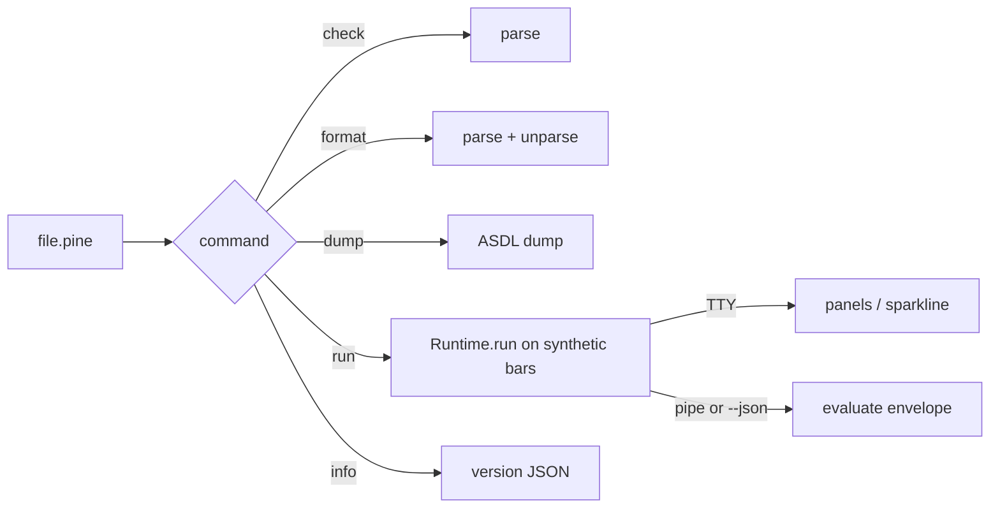

# Copyright (c) 2024-2026 HOOX · PyneTS · hoox-sh (jango_blockchained)

#

# This file is part of pyne-ts.

#

# pyne-ts is free software: you can redistribute it and/or modify

# it under the terms of the GNU Affero General Public License as published by

# the Free Software Foundation, either version 3 of the License, or

# (at your option) any later version.

#

# pyne-ts is distributed in the hope that it will be useful,

# but WITHOUT ANY WARRANTY; without even the implied warranty of

# MERCHANTABILITY or FITNESS FOR A PARTICULAR PURPOSE. See the

# GNU Affero General Public License for more details.

#

# You should have received a copy of the GNU Affero General Public License

# along with pyne-ts. If not, see <https://www.gnu.org/licenses/>.

#

# SPDX-License-Identifier: AGPL-3.0-or-later

---

title: "PyneTS CLI"
description: "pyne-ts check / format / run / dump / info — Rich TTY, JSON on pipes. run calls Runtime.run (Python equivalent is pyne execute)."
---

# PyneTS CLI

## Abstract

`pyne-ts` is a Bun CLI for parse, format, AST dump, and evaluate. TTY output is a Rich-inspired panel (PYNE volt palette). **Pipes and `--json` stay machine-readable.** Exit codes: `0` ok, `1` syntax/runtime, `2` usage.

**`pyne-ts run` calls `Runtime.run`**, matching Python **`pyne execute`**. Python `pyne run` is compile-only synthetic smoke. Default `--mode interpret`. `--mode compile` / `auto` select JS emit (`@hoox-sh/pyne-ts` **0.11.1**).

The `pyne-ts` bin is TypeScript with a `#!/usr/bin/env bun` shebang — it needs Bun on `PATH`. `npx` on a Node-only host will not run it.

## Conceptual model



## Interface surface

Captured from `bun run src/cli.ts -- help`:

```text
usage: pyne-ts <check|format|run|dump|info> [file] [--bars N] [--mode interpret|compile|auto] [--commission N] [--slippage N] [--pyramiding N] [--json] [--plain] [--rich] [--full]

commands:
  check      Parse-only validation (CI-friendly exit codes)
  format     Parse → unparse (pretty-print on TTY)
  run        Run on synthetic OHLCV (interpret or compile JS emit)
  dump       Dump the ASDL-shaped AST
  info       Version and runtime extras

options:
  --bars N         Synthetic bar count for run (default 20, max 100000)
  --mode MODE      run engine: interpret | compile | auto (JS emit; default interpret)
  --commission N   Broker commission fraction for run (e.g. 0.001)
  --slippage N     Broker slippage in price units for run
  --pyramiding N   Broker max same-direction adds for run
  --json           Machine-readable run / info output
  --indent N       AST dump indent (default 2)
  --full           Print the full AST dump (no 80-line cap)
  --plain          Disable Rich styling (wins over FORCE_COLOR)
  --rich           Force Rich styling (put after the command)
  -h, --help       Show this help

exit: 0 ok, 1 syntax/runtime, 2 usage
```

| Command       | Action                           | File required |
| ------------- | -------------------------------- | ------------- |
| `check`       | Parse-only validation            | yes           |
| `format`      | Parse → unparse (pretty on TTY)  | yes           |
| `run`         | `Runtime.run` on synthetic OHLCV | yes           |
| `dump`        | ASDL-shaped AST                  | yes           |
| `info`        | Version and runtime extras       | no            |
| `help` / `-h` | Usage                            | no            |

### Invocation

```bash
bunx pyne-ts -- <args>        # installed from npm
bun run pyne-ts -- <args>     # from a checkout (package.json script)
bun run src/cli.ts -- <args>  # from a checkout, direct
```

The `--` matters to `bunx` / `bun run`: flags after it go to the CLI, not to the runner.

### Path resolution

`resolveUserFile` takes **only** the path you typed (cwd-relative or absolute). No search path. Missing file → exit 2 (`error: file not found`). NUL bytes in the path are rejected.

### Synthetic bars

`run` builds a ramp: `close = 100 + i`, `open = close`, `high/low = close ± 0.5`, `volume = 1`, `time = 1700000000000 + i * 60000`. Symbol is hardcoded `AAPL`. This is a desk smoke, not a data provider.

## Internals

| Path              | Role                                     |
| ----------------- | ---------------------------------------- |
| `src/cli.ts`      | Arg parse, commands, exit codes          |
| `src/cli/rich.ts` | TTY paint, help, tables, sparkline       |
| `src/index.ts`    | `parse` / `unparse` / `dump` / `Runtime` |

`run` constructs `new Runtime("AAPL", { broker, mode }).run(source, syntheticBars(bars))`.

## Invariants & edge cases

1. **Pipe-safe.** Non-TTY `check` prints `ok`. Non-TTY `run` prints JSON.
2. `--rich` must come **after** the command (`pyne-ts -- run x.pine --rich`), because flags before the command are stripped for Rich detection.
3. Unknown flags and extra positional args are usage errors (exit 2).
4. `run` default mode is **`interpret`**, matching `new Runtime()` — not Pro API `auto`.
5. `--bars` is clamped; negative / non-integer → usage error.

## Worked examples

```bash
bunx pyne-ts -- check script.pine
bunx pyne-ts -- format script.pine
bunx pyne-ts -- dump script.pine --full
bunx pyne-ts -- run script.pine --bars 50
bunx pyne-ts -- run script.pine --mode compile --json
bunx pyne-ts -- run strat.pine --commission 0.001 --pyramiding 1
bunx pyne-ts -- info --json
```

CI:

```bash
bunx pyne-ts -- check script.pine
# stdout: ok
# exit 0 / 1 / 2
```

## Failure modes

| Symptom                                      | Cause                 | Fix                                                                                                                                                              |
| -------------------------------------------- | --------------------- | ---------------------------------------------------------------------------------------------------------------------------------------------------------------- |
| Exit 2 `missing file`                        | No path / ENOENT      | Pass a real file                                                                                                                                                 |
| Exit 1 on `check`                            | Syntax error          | Read the ANTLR message                                                                                                                                           |
| `run` JSON has `error` / `error_kind: parse` | Script does not parse | `pyne-ts check` first                                                                                                                                            |
| Expected compile-only like `pyne run`        | Different CLI         | Use Python `pyne run` for compile smoke; `pyne-ts run` is `Runtime.run` like `pyne execute`. See [PYNE modes](https://hoox.sh/pyne/docs/enduser/reference/modes) |
| Rich garbage in logs                         | TTY detected          | `--plain` or pipe                                                                                                                                                |

## See also

- [Install](/pyne-ts/docs/install)
- [Runtime](/pyne-ts/docs/runtime)
- [PYNE CLI](https://hoox.sh/pyne/docs/enduser/guides/cli)
- [Modes](https://hoox.sh/pyne/docs/enduser/reference/modes)
