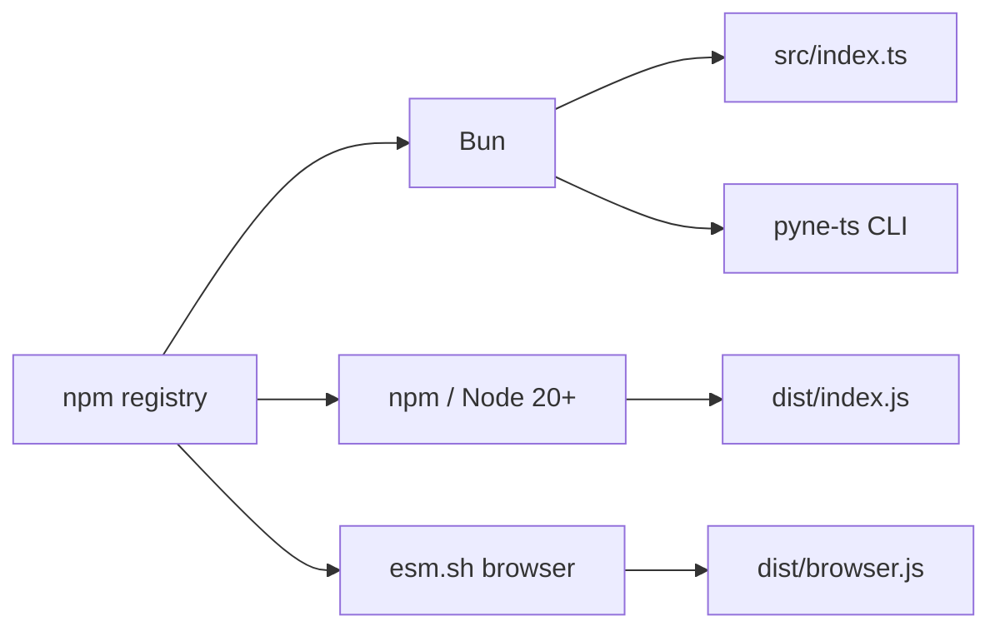

# Copyright (c) 2024-2026 HOOX · PyneTS · hoox-sh (jango_blockchained)

#

# This file is part of pyne-ts.

#

# pyne-ts is free software: you can redistribute it and/or modify

# it under the terms of the GNU Affero General Public License as published by

# the Free Software Foundation, either version 3 of the License, or

# (at your option) any later version.

#

# pyne-ts is distributed in the hope that it will be useful,

# but WITHOUT ANY WARRANTY; without even the implied warranty of

# MERCHANTABILITY or FITNESS FOR A PARTICULAR PURPOSE. See the

# GNU Affero General Public License for more details.

#

# You should have received a copy of the GNU Affero General Public License

# along with pyne-ts. If not, see <https://www.gnu.org/licenses/>.

#

# SPDX-License-Identifier: AGPL-3.0-or-later

---

title: "Install PyneTS"
description: "Add @hoox-sh/pyne-ts with Bun, npm, or esm.sh. CLI requires Bun. Node and browsers use the ESM bundle."
---

# Install PyneTS

## Abstract

`@hoox-sh/pyne-ts` is published to the npm registry. Bun imports the TypeScript source directly. Node 20+ and browsers consume the ESM bundle in `dist/`. The `pyne-ts` CLI is a Bun script.

Package: [npmjs.com/package/@hoox-sh/pyne-ts](https://www.npmjs.com/package/@hoox-sh/pyne-ts) · source: [github.com/hoox-sh/pyne-ts](https://github.com/hoox-sh/pyne-ts). Current version **0.11.1** (`latest` on npm, `package.json` agrees).

## Conceptual model



| Consumer     | Entry               | Notes                           |
| ------------ | ------------------- | ------------------------------- |
| Bun `>= 1.2` | `./src/index.ts`    | No bundle required              |
| Node `>= 20` | `./dist/index.js`   | Run `bun run build` / `prepack` |
| Browser      | `./dist/browser.js` | Same package; `exports.browser` |
| CLI          | `./src/cli.ts`      | Needs Bun on `PATH`             |

Exports map (`package.json`): the main entry plus subpaths `./parse` (`src/ast/helper.ts` under Bun, `./dist/parse.js` otherwise, `dist/parse.browser.js` for the browser) and `./runtime` (`src/runtime/interpret.ts` under Bun). `browser` resolves to the minified full browser bundle; `types` resolves to `dist/types/`.

## Interface surface

### Bun (recommended)

```bash
bun add @hoox-sh/pyne-ts
bunx pyne-ts -- help
bunx pyne-ts -- info
```

```ts
import { parse, unparse, Runtime } from "@hoox-sh/pyne-ts";
```

### Node 20+

```bash
npm install @hoox-sh/pyne-ts
```

```js
import { parse, Runtime } from "@hoox-sh/pyne-ts";
```

`npm pack` / publish runs `prepack` → `bun run build`. If you clone the repo and import from Node without building, resolution fails.

### Browser (esm.sh)

```html
<script type="module">
  import { Runtime } from "https://esm.sh/@hoox-sh/pyne-ts";
</script>
```

Pin a version in production, e.g. `https://esm.sh/@hoox-sh/pyne-ts@0.11.1`. This is a library import, not a hosted evaluate API. Note: `mode: "compile"` uses `new Function`, so it needs a CSP that allows `script-src 'unsafe-eval'` (or a worker with that policy). Under a strict CSP use `interpret`; for parser-only use, import `@hoox-sh/pyne-ts/parse` (the browser build is the `node:`-free minified bundle).

### From a PYNE checkout

```bash
git clone --recurse-submodules https://github.com/hoox-sh/pyne.git
cd pyne/pyne-ts
bun install
bun test
```

After a plain clone: `git submodule update --init --recursive`.

Published npm is **`@hoox-sh/pyne-ts` 0.11.1** (interpret + JS compile). `dist/` is gitignored — run `bun run build` in the library checkout if you need the Node/browser ESM bundle. Python Runtime remains the oracle.

### Develop the library

```bash
git clone https://github.com/hoox-sh/pyne-ts.git
cd pyne-ts
bun install
bun test
bun run typecheck
bun run check   # bun check + dependency-cruiser boundaries
bun run build
```

Grammar regen (needs Java + PYNE `.g4`):

```bash
bun run generate
```

Resolution order in `scripts/generate-antlr.ts`: `PYNE_TS_GRAMMAR` → `PYNESCRIPT_ROOT` → parent PYNE checkout → sibling `../pynescript` or `../pyne`. `PYNETS_GRAMMAR` still works as a deprecated alias for `PYNE_TS_GRAMMAR`.

## Internals

| Path                            | Role                                                             |
| ------------------------------- | ---------------------------------------------------------------- |
| `package.json` `exports`        | bun → `src/`, types → `dist/types/`, browser → `dist/browser.js` |
| `package.json` `bin.pyne-ts`    | `./src/cli.ts` (Bun shebang — not a Node binary)                 |
| `scripts/build.ts`              | Node + browser ESM → `dist/` (gitignored)                        |
| `scripts/generate-antlr.ts`     | ANTLR TS regen                                                   |
| `.github/workflows/publish.yml` | npm publish on `v*` tags                                         |

Local tooling is **Bun only**. Do not add npm/yarn/pnpm lockfiles. The npm registry is used only to publish.

## Invariants & edge cases

1. The CLI is **not** a Node-native binary. `npx pyne-ts` without Bun will fail — the `node >=20` engine field covers the library, not the CLI.
2. This package is **not** a Cloudflare Worker. There is no `wrangler` here.
3. Do not `npm install pyne-ts` (unscoped). The name is **`@hoox-sh/pyne-ts`**. The old `@hoox-sh/pynets` name is historical — install `@hoox-sh/pyne-ts`.
4. Do not confuse with `pip install hoox-pyne` (Python).
5. Engines field: `"bun": ">=1.2.0"`, `"node": ">=20"`.

## Worked examples

### Smoke the CLI

```bash
bunx pyne-ts -- info --json
# {"name":"pyne-ts","package":"@hoox-sh/pyne-ts","version":"0.11.1", ...}

printf 'indicator("x")\nplot(close)\n' > /tmp/x.pine
bunx pyne-ts -- check /tmp/x.pine
# TTY: panel; pipe: "ok"
```

### Library one-liner

```ts
import { Runtime } from "@hoox-sh/pyne-ts";

const out = new Runtime("AAPL").run(
  `indicator("sma")\nplot(ta.sma(close, 3))`,
  [{ close: 1 }, { close: 2 }, { close: 3 }, { close: 4 }],
);
if (out.error) throw new Error(out.error);
console.log(out.plots);
```

## Failure modes

| Symptom                                 | Cause                          | Fix                                        |
| --------------------------------------- | ------------------------------ | ------------------------------------------ |
| `Cannot find module '@hoox-sh/pyne-ts'` | Typo / stale `@hoox-sh/pynets` | Use `@hoox-sh/pyne-ts`                     |
| Node import fails in a fresh clone      | `dist/` not built              | `bun run build`                            |
| `pyne-ts: command not found`            | No Bun / not on PATH           | `bunx pyne-ts` or `bun run src/cli.ts`     |
| Grammar regen fails                     | No Java / no PYNE `.g4`        | Set `PYNESCRIPT_ROOT` or `PYNE_TS_GRAMMAR` |
| AXIS still evaluates via Python         | Expected                       | AXIS does not consume this package         |

## See also

- [PyneTS hub](/pyne-ts/docs)
- [CLI](/pyne-ts/docs/cli)
- [PYNE install](https://hoox.sh/pyne/docs/enduser/getting-started/installation)
- [Ecosystem](https://hoox.sh/pyne/docs/reference/ecosystem)
