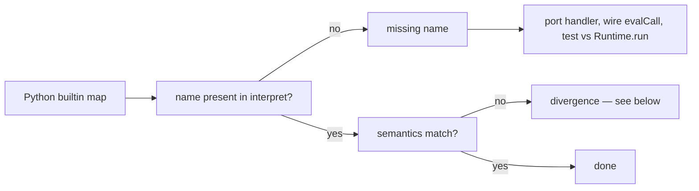

# Copyright (c) 2024-2026 HOOX · PyneTS · hoox-sh (jango_blockchained)

#

# This file is part of pyne-ts.

#

# pyne-ts is free software: you can redistribute it and/or modify

# it under the terms of the GNU Affero General Public License as published by

# the Free Software Foundation, either version 3 of the License, or

# (at your option) any later version.

#

# pyne-ts is distributed in the hope that it will be useful,

# but WITHOUT ANY WARRANTY; without even the implied warranty of

# MERCHANTABILITY or FITNESS FOR A PARTICULAR PURPOSE. See the

# GNU Affero General Public License for more details.

#

# You should have received a copy of the GNU Affero General Public License

# along with pyne-ts. If not, see <https://www.gnu.org/licenses/>.

#

# SPDX-License-Identifier: AGPL-3.0-or-later

---

title: "PyneTS missing features"
description: "What still differs between @hoox-sh/pyne-ts and Python pynescript.runtime, and what closed recently. 941/941 registered builtins resolve as of PYNE 0.6.32."
---

# PyneTS missing features

## Abstract

This page tracks what `@hoox-sh/pyne-ts` still does not match in Python `pynescript.runtime`. The oracle is Python `Runtime.run` on the same source and the same bars. It is not a TradingView® certification list.

As of **0.11.1** against **PYNE 0.6.32**, **all 941 names registered by PYNE's `BuiltinEvaluator` resolve** on both interpret and JS compile. The gap list is no longer a wall of absent builtins — it is the short set of behavioral divergences in [PARITY.md](https://github.com/hoox-sh/pyne-ts/blob/main/PARITY.md) plus the intentionally absent host features below. If this page and PARITY.md disagree, PARITY.md wins.

## Conceptual model



Port order when closing an item: read the winning Python method (mixin MRO, not a later duplicate), port `na` / lookback / call-site state, wire `evalCall` or the matching `eval*Call`, add `test/interpret_*.test.ts`, compare plots. Do not edit `src/runtime/compile/*` in the same change as `interpret.ts`.

## Closed since the last audit

Do not re-open these as missing.

| Area | What landed |
| ──────────────────── | ────────────────---------------------------------------------------------------------------------------------------------------------------------------------------------------------------------------------------------------------------------------------------------------------------------------------------------------------------------------------- |
| TA parity waves | Waves 11–13 (`ta.sma_weighted`, `ta.apo`, `ta.atr_normalized`, `ta.beta`, `ta.r_squared`, `ta.comovement`, `ta.skewness`, `ta.kurtosis`, `ta.volume_weighted_momentum`, `ta.parkinson`, `ta.garman_klass`, `ta.mean_reversion_score`, `ta.market_condition`, `ta.order_flow_imbalance`, `ta.liquidity_score`, `ta.fear_greed_index`, `ta.crowd_sentiment`, `ta.smart_money_flow`, `ta.trend_confirmation_score`, `ta.max_loss_level`, `ta.profit_lock_level`, `ta.position_sizing`, `ta.kelly_criterion`, `ta.risk_reward_ratio`, `ta.risk_reward_asymmetry`, `ta.probability_of_movement`, `ta.trend_strength`, `ta.breakeven_level`, `ta.market_structure_pivot`, `ta.position_sizing_score`, `ta.trailing_exit_level`, `ta.optimal_entry_zone`, `ta.mean_reversion_entry`, `ta.multi_timeframe_signal`, `ta.market_timing_index`, `ta.regime_adaptive_signal`, `ta.strategy_score`, `ta.breakout_detection`, `ta.ema_cross_signal`, `ta.momentum_filter`, `ta.volatility_regime`, `ta.economic_impact_score`, `ta.contrarian_signal`, `ta.drawdown_recovery_level`, `ta.pivot_point_levels`, `ta.volatility_regime_score`, `ta.correlation_filter`, `ta.advanced_breakout_detector`, `ta.pullback_bounce_level`, `ta.divergence_detector`, `ta.momentum_divergence`, `ta.spread_analysis`, `ta.employment_cycle_indicator`, `ta.gdp_growth_proxy`, `ta.inflation_proxy_indicator`, `ta.expected_value`) and wave 14 (`ta.gamma_levels` — returns a `PineArray`, use `array.get(g, 0)` — `ta.intelligent_strategy_synthesizer`, `ta.signal_confluence`). Every wave ships interpret **and** JS compile emit with Python `Runtime.run` parity tests. |
| Descriptor tables | 165 TA methods across 11 `Ta*Spec` tables in `src/runtime/ta_specs.ts`; both backends dispatch through them (0.11.x). Argument kinds, tuple outputs, runtime gates, and overloads are maintained once. |
| `once [cond]` | Parse, unparse, interpret, compile. Body runs the first time the test is true. Bare `once` runs on bar 0. Nested `once` inside `if` fires once. `na` does not fire. `x = once …` is a syntax error. |
| Realtime sessions | `RuntimeStream` / `Runtime.run(..., { realtimeLastBar, realtimeFromBar, realtimeBars, realtimeTicks })` model forming bars and multi-tick windows: intermediate ticks roll back `var`, TA, broker, and plot state; `varip` re-initializes per tick; `once` commits on confirmed bars only (matching Python `_run_batch`). `RuntimeStream` also gained `updateLastBar`, `appendBars`, `barCount`. |
| Multi-value `switch` | `1, 2 =>` matches any element on interpret and compile. |
| Matrix row/col | `sum_*`, `avg_*`, `min_*`, `max_*`, `mode_*`, `copy_row` / `copy_col`, `fill_row` / `fill_col` / `fill_diagonal`, `reverse_rows` / `reverse_cols`, `stdev`, `variance`. |
| Host helpers | `timeframe.change`, `time_close` / `time_close()`, `syminfo.prefix` and `syminfo.prefix(tickerid)`, bare `round_to_mintick`, every Python `array.new*` spelling, `plotcandle` / `plotbar`, `timenow`, `max_bars_back`, `alertcondition`, `plot.linestyle_*`, `plot.style_*`, `alert.freq_*`, `alert()` frequency gating, bare `random`, bare `security` / `security_lower_tf`, bare chart-type aliases `renko` / `kagi` / `linebreak` / `pointfigure`, `ticker.inherit`, bare `percentile_linear_interpolation` / `percentile_nearest_rank`. |
| Footprint | `request.footprint` Python mock on interpret and compile. `footprint.*` and `volume_row.*` accessors. `request.seed` seeds the mock RNG. Missing id is `0` / empty / `na` as Python. |
| Strategy | `strategy.cash` is free cash tagged `_pine_qty_type="cash"`; `account_currency`, `position_entry_name`, `default_entry_qty`, `convert_to_*`, `max_contracts_held_*`, closed/open trade time/comment/drawdown/runup/commission/capital_held/`first_index`; `oca.*`, `direction.*`, `commission.*` constants; zero-arg series calls (`strategy.netprofit()`). Market orders fill at the **next** bar's open (PYNE 0.6.29 reference-Pine flow), on interpret and compile. |
| Drawings | Getters, remaining setters, `*.all`, `*.copy`, remaining deletes, `chart.point.*`, `line.fill`, on interpret and compile. Constructor coords snapshot so getters after `new` are not `na`. |

`ta.rci` with length under 2 is a runtime error whose message contains `ta.rci length must be at least 2`.

## Still open

Carried in [PARITY.md](https://github.com/hoox-sh/pyne-ts/blob/main/PARITY.md). These are the actual remaining gaps — everything else is closed.

1. **Nested `ta.*` arguments in bar mode.** Python rejects them (`ta.mean_reversion_entry` raises); PyneTS accepts them. A superset, not a plot difference — but scripts relying on the error behavior will diverge.
2. **`data_feed` forming-bar polling is not modeled.** Python without a feed re-visits the same OHLC on realtime ticks; PyneTS does the same. No live vendor feed is implied.
3. **`request.security` foreign / HTF without a feed returns `na`.** That is the Python policy, on both sides. It is not a hole to fill with invented bars.

### Python quirks that are load-bearing

- `ta.market_structure_pivot` implements the `advanced.py` semantics (oldest `period` highs/lows, midpoint pivot) because it wins MRO over the `strategies.py` variant.
- `ta.breakout_detection` treats a bare series argument as `0` (Python `isinstance` check), matching PYNE's bar-mode quirk.
- `ta.mean_reversion_entry` parity requires series arguments; Python errors on nested `ta.sma` / `ta.stdev` in bar mode.

### `ta.*` semantics worth knowing

- `ta.tsi` returns the raw ratio in `[-1, 1]`, not percent.
- `ta.pivothigh` / `ta.pivotlow` confirm the center bar `right` bars back; left ties confirm, the right side is strict.
- `ta.sar` seeds `low[0]`, emits `na` on the first valid bar, emits the seed on the second, then Wilder's step with the two-bar clamp.
- `ta.max` / `ta.min` use the expanding whole-history reduction for the unary form; a second period switches to the rolling alias.
- `ta.stdev` / `ta.variance` / `ta.bb` use population variance (ddof = 0).
- `ta.atr` seeds bar 0 with `high - low` (PYNE 0.6.32 `_atr_inc_update`).
- History lists (`_expect_list`) are **newest-first**, capped at 1000; `g[0]` on a `ta.gamma_levels` result is the _last_ element.

### Compile emit coverage

The names in the closed list above emit on both backends. Where emit and interpret disagree, Python decides — never ship a compile-side "fix" that diverges from Python interpret. If you suspect an emit-only bug, compare `mode: "interpret"` against Python first, then compile.

## Internals

| Path | Role |
| ────────────────------------------------------------------------------------------------------------- | --------------------------------------------------------------------------------------------------------------------------------------------------------------------------- |
| PYNE `src/pynescript/ast/evaluator/builtins/` | Handler source of truth. `TechnicalAnalysisMixin` MRO: Advanced, Basic, Common, MovingAverage, Oscillator, Pattern, Economics, Strategies, Synthesizer, Volatility, Volume. |
| PYNE `technical_submodules/core.py` | Incremental kernels (`_use_incremental_ta`). |
| `src/runtime/interpret.ts` | `evalCall` and `eval*Call`. |
| `src/runtime/ta.ts`, `ta_specs.ts`, `ta_names.ts`, `matrix.ts`, `drawings.ts`, `strategy.ts`, `timeframe.ts`, `footprint.ts` | State, descriptor tables, manifest, values. |
| `src/runtime/compile/emit_call.ts` | Compile dispatch. Do not edit it in the same change as `interpret.ts`. |
| `test/interpret_*.test.ts` | Focused parity tests. |

`last_bar_index`, `last_bar_time`, and `syminfo.ticker` are not missing. The first two are written in `beginBar`. `syminfo.ticker` / `tickerid` return the runtime symbol.

## Invariants & edge cases

1. Python wins. If a port would plot a nicer series than `Runtime.run`, do not land it.
2. `na` is `null`. Non-finite in or out is `na`.
3. TA state is one sample per bar, keyed by call site.
4. Dict-shaped `ta.*` results are `__taRecord` objects. `evalAttribute` reads only that brand.
5. `strategy.cash` plots free cash and still tags `default_qty_type`.
6. Numba, Worker packaging, and ASDL codegen are out of scope for this repo. They are not rows on this list.

## Worked examples

Compare before closing a row:

```bash
# PyneTS
bun -e 'import { Runtime } from "./src/index.ts";
console.log(new Runtime("TEST").run(`//@version=5
indicator("t")
plot(ta.dpo(20))`, [{close:1},{close:2},{close:3}]))'

# Python
/path/to/pynescript/.venv/bin/python -c 'from pynescript.runtime import Runtime
print(Runtime("TEST").run("""//@version=5
indicator("t")
plot(ta.dpo(20))""", [{"close":1},{"close":2},{"close":3}], mode="interpret"))'
```

Suggested order of work:

1. The Python quirks above, when a script actually trips them.
2. Anything newly missing from the next PYNE release — port it the same way: read the Python handler, port `na` / lookback / call-site state, wire both backends, add a parity test.
3. Leave the rest alone until a script needs it.

## Failure modes

| Symptom                                        | Cause                                                           |
| ---------------------------------------------- | --------------------------------------------------------------- |
| Plot differs from Python on a wave-11+ builtin | Port bug — compare against Python interpret, not against TV     |
| `ta.gamma_levels` element is `na`              | Use `array.get(g, 0)`; `g[0]` is the **last** pushed element    |
| Compile plots `na`, interpret matches Python   | Name not wired in emit — compare modes before blaming interpret |
| A realtime tick fires `once` twice             | Tick rolled back but `once` state did not — file a repro        |
| `newest-first` list read backwards             | History lists are newest-first; `list[-1]` is the oldest        |

## See also

- [PyneTS parity](/pyne-ts/docs/parity)
- [PyneTS runtime](/pyne-ts/docs/runtime)
- [JS compile](/pyne-ts/docs/compile)
- [PYNE missing features](https://hoox.sh/pyne/docs/reference/missing-features)
- [Drawing and plotting](https://hoox.sh/pyne/docs/runtime/builtins/drawing-plotting)
- [Strategy](https://hoox.sh/pyne/docs/runtime/builtins/strategy)
