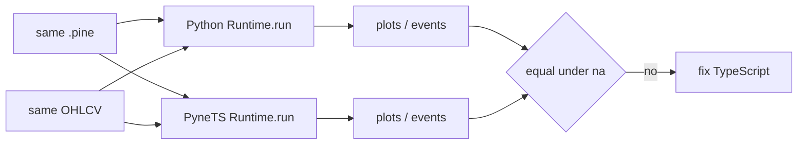

# Copyright (c) 2024-2026 HOOX · PyneTS · hoox-sh (jango_blockchained)

#

# This file is part of pyne-ts.

#

# pyne-ts is free software: you can redistribute it and/or modify

# it under the terms of the GNU Affero General Public License as published by

# the Free Software Foundation, either version 3 of the License, or

# (at your option) any later version.

#

# pyne-ts is distributed in the hope that it will be useful,

# but WITHOUT ANY WARRANTY; without even the implied warranty of

# MERCHANTABILITY or FITNESS FOR A PARTICULAR PURPOSE. See the

# GNU Affero General Public License for more details.

#

# You should have received a copy of the GNU Affero General Public License

# along with pyne-ts. If not, see <https://www.gnu.org/licenses/>.

#

# SPDX-License-Identifier: AGPL-3.0-or-later

---

title: "PyneTS parity"
description: "How to compare @hoox-sh/pyne-ts Runtime.run plots against Python pynescript.runtime. Python wins ties."
---

# PyneTS parity

## Abstract

Parity here means **TypeScript `Runtime.run` vs Python `Runtime.run`** on the same source and the same bars — not vs TradingView. Interpret↔compile alignment **inside** PyneTS is a second, narrower check (`test/compile_*.test.ts`).

Workflow when adding or fixing a builtin: read the Python handler, port `na` / lookback / call-site semantics, wire `evalCall` or the matching `eval*Call`, add a focused `test/interpret_*.test.ts`, compare plots if PYNE is present.

## Current snapshot

From [`PARITY.md`](https://github.com/hoox-sh/pyne-ts/blob/main/PARITY.md) — the file, not this page, is the authority. As of **PYNE 0.6.32** (snapshot refreshed 2026-11):

| Metric                   | Value                                            |
| ------------------------ | ------------------------------------------------ |
| PYNE-registered builtins | **941 / 941** resolve                            |
| Test suite               | **1,468** tests — 1,322 pass · 146 skip · 0 fail |
| TA methods               | **165** on shared descriptor tables (11 tables)  |
| Dispatch names           | **317** (bare + `ta.` prefix)                    |
| Parity tests             | Run against the local PYNE checkout when present |

The 146 skipped tests are the ones that need PYNE on `PYTHONPATH`; they skip cleanly when it is absent. Structural aliases handled outside the quoted dispatch map (`color.*`, `*.all` drawings, `syminfo.*`, `last_bar_time`) are counted separately — see `PARITY.md`.

## Conceptual model



## Interface surface

### Commands

```bash
# PyneTS
cd /path/to/pyne-ts
bun test
bun test test/interpret_ta.test.ts
bun run typecheck

# Python oracle (sister checkout)
cd /path/to/pynescript
python -c "from pynescript.runtime import Runtime; ..."
```

Use `/pyne-ts-parity` when adding or fixing builtins. Use `/pyne-ts-generate` when touching grammar output.

The Python probe in `test/helpers/python_runtime.ts` puts `$PYNESCRIPT_ROOT/src` on `PYTHONPATH`, so parity tests always import the local source tree — never an installed `pynescript` release — and skip cleanly when PYNE is absent. `$PYNESCRIPT_ROOT` defaults to `/home/jango/Git/pynescript` on the maintainer's machine; set it to wherever your checkout lives.

### What to compare

| Field                   | Rule                                                             |
| ----------------------- | ---------------------------------------------------------------- |
| `plots` / `series`      | Equal length; `null` ↔ Python `None`; finite numbers match       |
| `events`                | Kind, direction, bar, id — same contract as PYNE strategy events |
| `error_kind`            | Same class of failure (`parse` vs `runtime`)                     |
| TradingView screenshots | **Out of scope** as an oracle                                    |

`na` encoding: Python interpret uses `None`; JSON / TS uses `null`; Python Numba uses `nan`. Compare after normalizing non-finite → `na`.

## Internals

| Path                                          | Role                    |
| --------------------------------------------- | ----------------------- |
| `test/interpret_*.test.ts`                    | Focused interpret cases |
| `test/compile_*.test.ts`                      | JS emit vs interpret    |
| `test/helpers/python_runtime.ts`              | Python oracle probe     |
| PYNE `src/pynescript/ast/evaluator/builtins/` | Handler SoT             |
| PYNE `tests/test_first_party_ta_goldens.py`   | Python goldens          |

Do **not** treat historical `pine-worker/test/parity/` JSON as the PyneTS harness. That tree lives in the leftover TypeScript Worker sister ([hoox-sh/pine-worker](https://github.com/hoox-sh/pine-worker)), not here.

`@hoox-sh/pyne-ts` ships interpret tests and compile-vs-interpret cases (`test/compile_*.test.ts`), plus per-wave parity tests (`test/interpret_wave11.test.ts` … `test/interpret_wave14.test.ts`). Python Runtime remains the oracle.

## Invariants & edge cases

1. **Python wins ties.** If TS and Python disagree, fix TS (unless Python is proven wrong — then fix both + tests).
2. **Do not "improve" semantics.** Port `na`, lookback, and call-site keys as Python implements them.
3. Same-symbol `request.security` may pass through; **foreign without data is `na` on both sides**.
4. Compile-vs-interpret inside PyneTS can pass while TS-vs-Python still fails — check both.
5. First-party fixtures live in PYNE; do not copy corpora into this repo's tests beyond what the suite already vendors.

Known sharp edges carried in `PARITY.md` (open, not regressions):

- Python rejects nested `ta.*` arguments in bar mode (`ta.mean_reversion_entry`); PyneTS accepts them.
- Python's `data_feed` forming-bar polling is not modeled; ticks re-visit the same OHLC (as Python without a feed does).
- `ta.market_structure_pivot` implements the `advanced.py` semantics (MRO winner).
- `ta.breakout_detection` treats a bare series argument as `0` (Python `isinstance` check).
- `ta.mean_reversion_entry` parity requires series arguments.

## Worked examples

### Minimal Python vs TS

Python:

```python
from pynescript.runtime import Runtime

src = 'indicator("t")\nplot(close[1])'
bars = [{"close": 10}, {"close": 20}]
print(Runtime(symbol="TEST").run(src, bars))
```

TypeScript:

```ts
import { Runtime } from "@hoox-sh/pyne-ts";

const src = 'indicator("t")\nplot(close[1])';
const bars = [{ close: 10 }, { close: 20 }];
console.log(new Runtime("TEST").run(src, bars));
```

Last-bar plot should be `10` on both.

### Adding a builtin

1. Read the Python handler (and its `_*_inc_update` when bar mode uses one).
2. Implement in `src/runtime/ta.ts` (stateful) or as a pure method.
3. Wire `evalExtraTa` in `src/runtime/interpret.ts` with Python arg order and required-arg messages. Add the manifest entry in `src/runtime/ta_names.ts`; add a `TaSrcLenSpec`/`TaContextCallSpec`/… in `src/runtime/ta_specs.ts` when the signature fits a descriptor, plus the `emitTa` branch in `src/runtime/compile/emit_call.ts`.
4. Add `test/interpret_<area>.test.ts`.
5. If PYNE is present, compare `Runtime.run` plots on the same bars.
6. `bun test` and `bun run typecheck`.

## Failure modes

| Symptom                               | Cause                | Fix                              |
| ------------------------------------- | -------------------- | -------------------------------- |
| Off-by-one vs Python                  | Lookback / bar_index | Match `PineSeries` to Python     |
| `null` vs `0`                         | `na` collapsed       | Keep `null`; do not coerce       |
| Foreign security equals chart         | Invented bars        | Return `na`                      |
| Compile matches interpret, both wrong | Shared host bug      | Fix interpret first (Python SoT) |
| Copied sources into PYNE              | Submodule rule       | PYNE consumes `pyne-ts/` only    |

## See also

- [PyneTS missing features](/pyne-ts/docs/missing-features)
- [PyneTS hub](/pyne-ts/docs)
- [Runtime](/pyne-ts/docs/runtime)
- [PYNE interpret↔compile parity](https://hoox.sh/pyne/docs/runtime/compiler/parity)
- [Compatibility](https://hoox.sh/pyne/docs/reference/compatibility)
- [Contributing](https://hoox.sh/pyne/docs/contributing)
